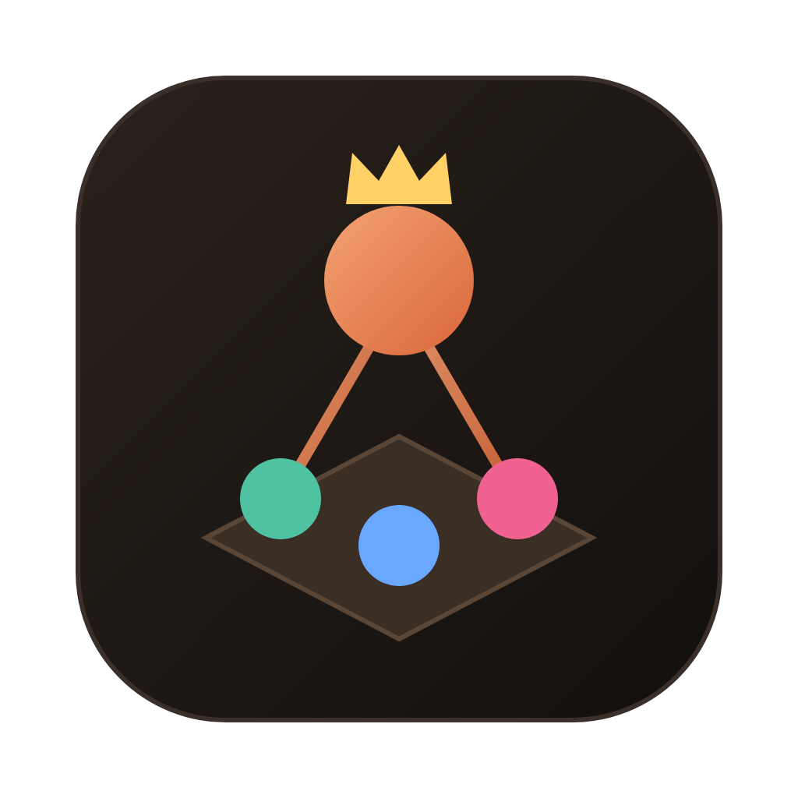
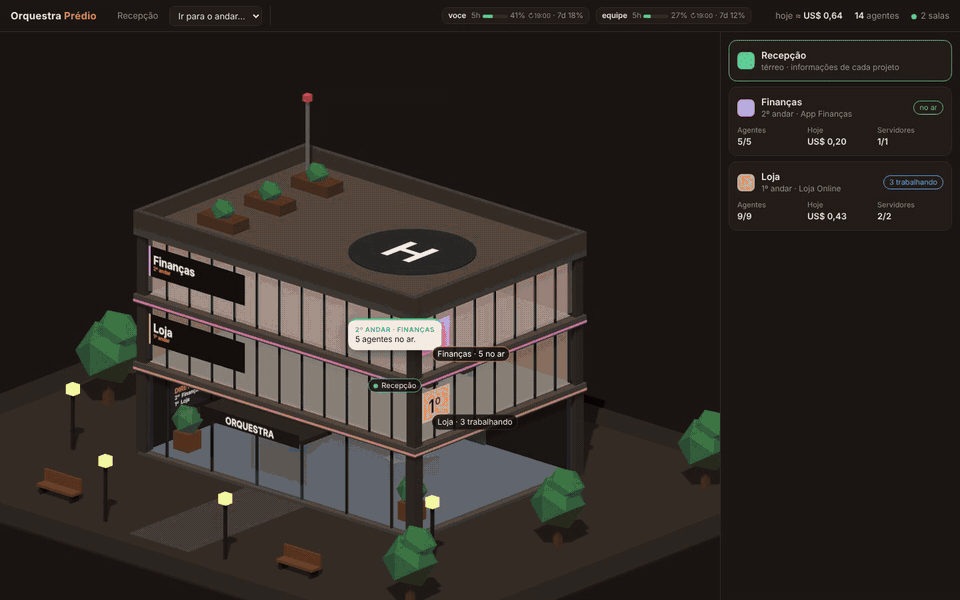
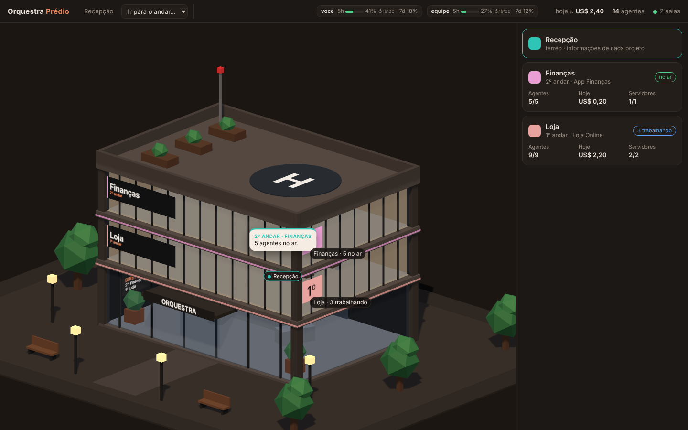
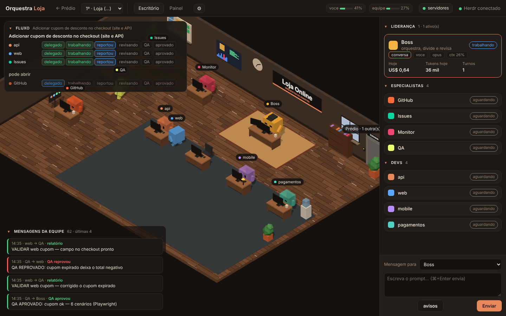
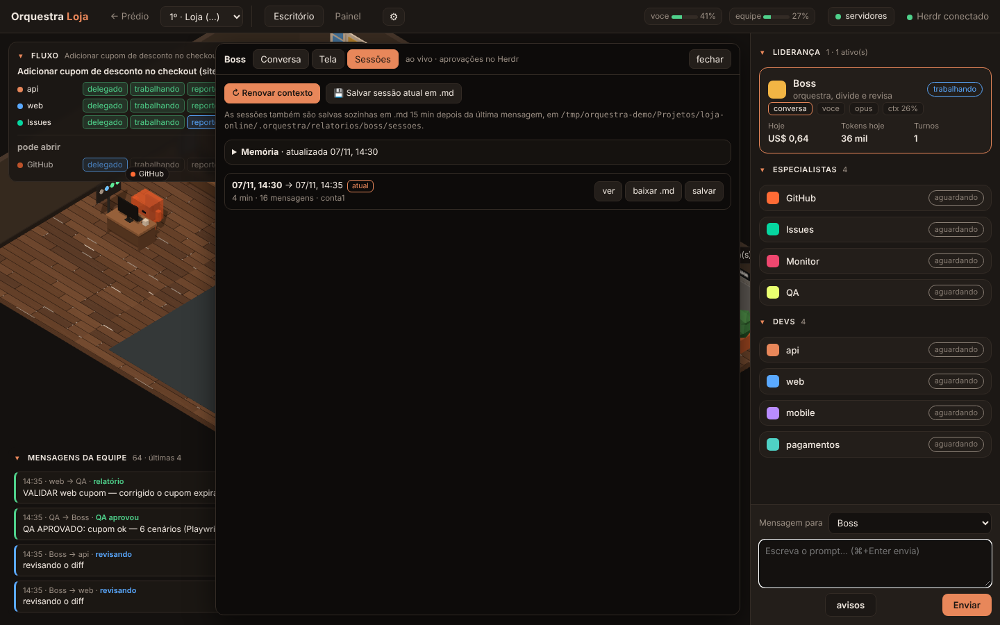
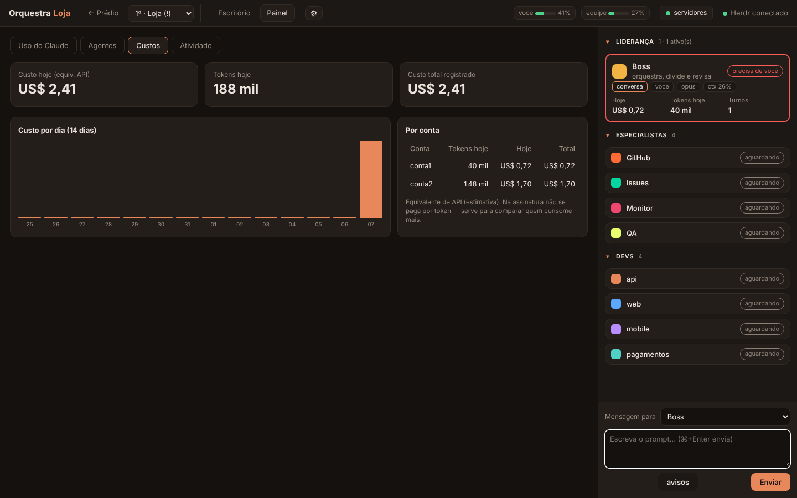

<p align="center"></p>

<h1 align="center">Orquestra</h1>

<p align="center"><b>Um escritório 3D para orquestrar agentes de IA.</b><br>
Um <b>Boss</b> por projeto conversa com você e delega para <b>devs</b>, <b>QA</b> e <b>especialistas</b> — todos agentes do <a href="https://claude.com/claude-code">Claude Code</a> rodando no <a href="https://herdr.dev">Herdr</a>. Você vê tudo acontecer, aprova e acompanha custos.</p>

<p align="center"></p>
<p align="center"><a href="docs/demo.mp4">▶ vídeo completo (1 min)</a> · <a href="#english">English</a></p>

---

## O que ele faz

- **Prédio com um andar por projeto** — cada andar tem seu Boss e sua equipe, isolados dos outros.
- **Fluxo ao vivo** — você pede → Boss delega → devs trabalham → QA testa no navegador (Playwright) → Boss revisa → você aprova → PR aberto. Os bonecos andam até a mesa de quem recebe o trabalho.
- **Conversa e tela de cada agente**, e envio de prompts pela interface.
- **Sessões sob controle** — renovar contexto (o agente resume o trabalho em `memoria.md`, limpa a sessão e relê só o resumo), salvar/ver/baixar sessões em `.md`, retomar sessões antigas, escolher se cada um começa do zero ou continua.
- **Uso e custo** — sessão de 5 h e limite semanal de cada conta do Claude, custo estimado por agente e por dia.
- **Servidores do projeto** — portas em uso, subir, parar e derrubar serviços (inclusive Docker Compose).
- **Alertas** — monitor de logs, pipeline que falhou, issue nova.

| Prédio | Sala |
|---|---|
|  |  |
| **Sessões do agente** | **Painel de custos** |
|  |  |

## Experimente sem instalar nada (modo demonstração)

Precisa só do Node.js 20+:

```bash
git clone https://github.com/juliocsilvestre/orquestra.git
cd orquestra
node demo/demo.mjs        # abre em http://localhost:4790
```

Dois projetos fictícios ("Loja Online" e "App Finanças") com agentes simulados — sem Herdr, sem Claude, sem custo.

## Instalação

### Requisitos

| | |
|---|---|
| [Herdr](https://herdr.dev) | terminais dos agentes (CLI `hc`) |
| [Claude Code](https://claude.com/claude-code) | os agentes (`claude`), logado na sua conta |
| Node.js 20+, Python 3, git | servidor e scripts |
| `gh` (opcional) | o agente GitHub abre os PRs |
| Docker (opcional) | se os serviços do seu projeto usam |

### macOS

**Pelo release (mais fácil):** baixe o `.dmg` em [Releases](../../releases), arraste o Orquestra para Aplicativos.
Enquanto o app não é assinado pela Apple, na 1ª vez abra com **botão direito → Abrir** (ou rode `xattr -cr /Applications/Orquestra.app`).

**Pelo código:**

```bash
git clone https://github.com/juliocsilvestre/orquestra.git
cd orquestra
bash instalar-mac.sh      # gera o Orquestra.app e instala em /Applications
```

### Linux

**Pelo release:** baixe o `.AppImage` (qualquer distro) ou o `.deb` (Ubuntu/Debian) em [Releases](../../releases).

```bash
chmod +x Orquestra-*.AppImage && ./Orquestra-*.AppImage
# ou
sudo apt install ./orquestra_*.deb
```

**Pelo código:**

```bash
git clone https://github.com/juliocsilvestre/orquestra.git
cd orquestra
npm install
npm run dist:linux        # gera dist/*.AppImage e dist/*.deb
```

### Windows

Ainda não — veja o [TODO](TODO.md). Por enquanto, use pelo WSL2 com o modo navegador abaixo.

## Criando o seu primeiro andar

Organize o projeto como uma pasta que contém os repositórios:

```
~/Projetos/minha-loja/
├── api/        (repo git)
└── web/        (repo git)
```

Depois:

```bash
./novo-andar.sh ~/Projetos/minha-loja --titulo "Minha Loja" --id loja
echo 'source ~/.orquestra/atalhos.zsh' >> ~/.zshrc     # uma vez só
```

Isso cria `~/Projetos/minha-loja/.orquestra` com:

- **Boss** (`boss/CLAUDE.md`) — complete o mapa dos repos: quanto melhor o mapa, melhores as tarefas;
- **um dev residente por repo**, cada um no seu *git worktree* (`.worktrees/dev-<repo>`), em branches `agente/<slug>`;
- **QA** com Playwright e **GitHub** para abrir PRs;
- `servicos.conf` — os comandos para subir cada serviço (descomente os que quiser).

Então, **num terminal do Herdr**, rode o atalho:

```bash
loja
```

Ele sobe o servidor, os serviços, a equipe e o Boss. Converse com o Boss ali mesmo ou pela interface (app Orquestra ou `http://localhost:4777`).

Com duas contas do Claude, use `--contas 2`: o Boss fica na conta 1 e a equipe na conta 2 (`.orquestra/bin/setup-conta2.sh` prepara a segunda).

## Segurança e custo

- Devs **não** fazem push, merge, deploy nem leem `.env`/chaves — são bloqueios reais de permissão do Claude Code (`dev-settings.json`), não só instruções.
- O Boss **não** fala com agentes de outro projeto (`hcp.sh` recusa) e não edita código.
- **PR e merge só depois do seu OK.**
- Os agentes não ficam em espera ativa; o contexto é renovado com resumo em `.md` em vez de crescer para sempre.

## Como funciona

```
Herdr (terminais)  ──hc events──▶  server/server.mjs  ──SSE──▶  interface 3D (Three.js)
Claude Code hooks  ──events.jsonl──▲        │
transcripts (.jsonl) ── uso, custo e conversa┘
```

O app de desktop (Electron) só abre o servidor e mostra a interface numa janela — fechar a janela não para os agentes.

## Desenvolvimento

```bash
npm install
npm start               # app
node demo/demo.mjs      # servidor com dados de demonstração
npm run dist:mac        # .dmg e .zip
npm run dist:linux      # AppImage e .deb
```

## Licença

[MIT](LICENSE)

---

<a id="english"></a>
## English

**Orquestra** is a 3D office for orchestrating AI coding agents. Each project is a floor with its own **Boss** (a Claude Code agent that plans, delegates and reviews), resident **devs** (one per repo, each in its own git worktree), a **QA** agent that tests in the browser with Playwright, and a **GitHub** agent that opens PRs — after your approval. Agents run in [Herdr](https://herdr.dev) terminals; the app shows the live flow, each agent's conversation and screen, session management (renew context with a Markdown summary, save/resume sessions), Claude usage limits and estimated cost, and your project's running services.

- Try it: `node demo/demo.mjs` → http://localhost:4790 (simulated agents, no Herdr/Claude needed)
- macOS: download the `.dmg` from Releases, or `bash instalar-mac.sh`
- Linux: `.AppImage` / `.deb` from Releases, or `npm install && npm run dist:linux`
- New project floor: `./novo-andar.sh <folder-with-repos> --titulo "My Shop" --id shop`, then run `shop` inside a Herdr terminal

The interface is currently in Portuguese; English is on the roadmap.
